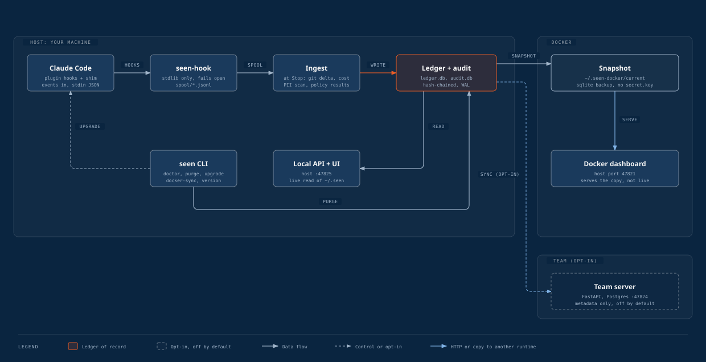

<p align="center"></p>

# Seen

[](https://github.com/surenganne/seen/actions/workflows/ci.yml)

**Nothing your agents do goes unseen.** A Claude Code plugin and local dashboard that keeps a per-project
ledger of what AI agents change: files and lines, tokens and API-equivalent cost, skills run
(with versions and approvals), required-skill rules, PII exposure, and a tamper-evident audit trail.

Local first: everything works with no server. Prompts and diffs never leave the machine.

## What it records, per agent turn

| | |
|---|---|
| Changes | Files touched and lines added/removed, reconciled to git |
| Cost | Input, output, cache read and write tokens (exact, from the transcript) and API-equivalent cost from `pricing/prices.json` |
| Timeline | What changed in the repo by day: who asked, what it changed, and the commit it ended on |
| Skills | Every skill that ran, its version hash, trigger, and approval status at that moment |
| Rules | `.seen/policies.yaml`: "changes to `llm/**` must run `phi-redaction-check`" (report or enforce) |
| PII | Types and counts of personal data and secrets that reached the model, the network or the repo, and from where. Never the values |
| Audit | Append-only, hash-chained events. `seen audit verify` finds the first edited, deleted or reordered row |

## Architecture



Hooks never touch the network or write SQLite: they append to a spool file and ingest folds it into the ledger
and the hash-chained audit database when the turn stops. The host dashboard reads `~/.seen` live. A container
cannot safely share SQLite WAL files with the host, so the Docker dashboard serves a snapshot made by
`seen docker-sync`. The team server only ever
receives metadata, and only when you switch sync on. Source: [docs/architecture.html](docs/architecture.html).

## Install

Seen is not on PyPI yet; install the CLI and the plugin straight from GitHub.

```bash
# 1. CLI and the seen-hook binary (Python 3.11+, uv)
uv tool install "git+https://github.com/surenganne/seen#subdirectory=packages/cli"

# 2. Claude Code plugin (marketplace "seen-tools" lives in this repo)
claude plugin marketplace add surenganne/seen
claude plugin install seen@seen-tools

# 3. Per repo
cd your-repo && seen init          # .seen/ folder: policies, PII rules, skills lockfile
seen doctor                        # checks Python, hooks, plugin, databases, PATH
```

Upgrade the CLI and the plugin together:

```bash
seen upgrade --check          # versions, skew warnings, and the commands it would run
seen upgrade --yes            # reinstall the CLI from where it came from, then update the plugin
seen version                  # every piece's version and the ledger schema
```

Then restart Claude Code. `seen doctor` also warns when the plugin, the `seen-hook` binary or the ledger schema
disagree with the CLI, and when a newer release tag exists on GitHub (one anonymous GET; opt out with
`SEEN_NO_UPDATE_CHECK=1`). Inside Claude Code, `/seen:upgrade` does the check and asks before upgrading.

Teams can enable it for everyone from the repo's `.claude/settings.json`; Claude Code installs it after a
contributor accepts the workspace trust dialog:

```json
{
  "extraKnownMarketplaces": { "seen-tools": { "source": { "source": "github", "repo": "surenganne/seen" } } },
  "enabledPlugins": { "seen@seen-tools": true }
}
```

## Use

```bash
seen report --days 7          # what changed, what it cost, which skills ran
seen blame src/app.py       # who wrote each line: agent, human or not observed (--rev, --json)
seen serve --open             # the dashboard on your real data (needs a web build once: see Dashboard)
seen pr-report --base main    # who wrote the lines a branch adds, for a PR (--post [--yes] comments via gh)
seen skills scan | list
seen import --dry-run         # past sessions from Claude Code transcripts (before the plugin was installed)
seen audit verify
seen purge --before 2026-01-01      # report what would be erased; add --yes to erase (DPDP)
seen docker-sync --watch 300 --restart   # keep the Docker dashboard's copy of ~/.seen fresh
seen audit export --format csv --from 2026-10-01 --to 2026-10-31
```

## Dashboard

A local web UI over the same ledger: **Projects** and **Overview** (cost, tokens, skills, PII),
**Changes**, **Sessions** and **Timeline** (every agent turn, by session and by day, with the files, skills and findings behind each number),
**Skills** (versions and approvals), **Audit** (the hash-chained trail, with verify and export) and
**Settings** (PII detection is editable; sync and retention are shown). Summaries link to the rows behind them.

The UI is a built bundle that is not packaged with the CLI, so build it once from a clone:

```bash
git clone https://github.com/surenganne/seen && cd seen
(cd web && npm ci && npm run build)
```

Then pick how to run it:

| | Command | URL | Data |
|---|---|---|---|
| **On the host** (recommended) | `SEEN_WEB_DIST=$PWD/web/dist seen serve --port 47825 --open` | http://127.0.0.1:47825 | Your real `~/.seen`, live |
| From a clone | `uv run seen serve --open` (finds `web/dist` itself; default port 47821) | http://127.0.0.1:47821 | Your real `~/.seen`, live |
| In Docker | `seen docker-sync && docker compose up -d --build` | http://127.0.0.1:47821 | A snapshot of `~/.seen`, refreshed by `seen docker-sync --watch 300 --restart` |
| UI development | `docker compose --profile dev up -d` | http://127.0.0.1:47822 | The Docker dashboard's data, with hot reload |

The dashboard has no login: it binds to 127.0.0.1 only, rejects other `Host` headers and requires a custom header
on every write, and `seen serve` refuses a non-loopback address unless you pass `--allow-remote` (containers only).
Do not publish its port beyond localhost. `seen dev-seed --home <scratch dir>` fills a throwaway home with generated
data for trying the UI; it refuses `~/.seen`.

## Docker

Hooks and the CLI run on the host (that is where Claude Code and your repos are). Docker runs the dashboard,
the test suites and the team server. Ports avoid the common defaults.

| Command | What | URL |
|---|---|---|
| `seen docker-sync && docker compose up -d --build` | Dashboard on a snapshot of your real `~/.seen` | http://127.0.0.1:47821 |
| `seen docker-sync --watch 300 --restart` (host) | Keep the container near-live: snapshot every 5 minutes, then restart the dashboard | |
| `docker compose --profile dev up -d` | Plus the Vite dev server with hot reload | http://127.0.0.1:47822 |
| (host dashboard) | The container never opens the live ledger: SQLite WAL locking does not cross the Docker Desktop VM; see Dashboard above | |
| `docker compose --profile test run --rm tests` | Python lint, types and unit tests | |
| `docker compose --profile test run --rm e2e` | Playwright against a throwaway, freshly seeded test database (tmpfs) | |
| `sh deploy/init-env.sh` then `docker compose -f deploy/docker-compose.team.yml --env-file deploy/.env up -d` | Team server (Phase 5 skeleton) and Postgres | http://127.0.0.1:47824, Postgres on 47823 |

Development data never touches your real ledger: `seen dev-seed` only writes into an explicit scratch
`SEEN_HOME`, every test gets its own temporary one, and the team test suite uses a separate
`seen_team_test` database.

The Docker dashboard needs nothing on the host except the CLI (`seen docker-sync`); the image builds the UI itself.

## Develop

```bash
git clone https://github.com/surenganne/seen && cd seen
uv sync && (cd web && npm ci)
uv run pytest                                  # unit + integration (fast, no network)
uv run pytest -m e2e tests/e2e                 # real headless Claude Code sessions (costs a few cents)
(cd web && npx playwright test)                # browser e2e, desktop and phone, CSP-violation guard
uv run python scripts/pii_benchmark.py         # regenerates docs/pii-benchmark.md
```

Phase 0 findings about Claude Code hooks are in [docs/hooks-findings.md](docs/hooks-findings.md); every parser
is tested against payloads and transcripts recorded from real sessions (`tests/fixtures`). CI runs Python
lint/types/tests, the web checks, Playwright and the Docker suites on every push.

## Docs

| | |
|---|---|
| [docs/TESTING.md](docs/TESTING.md) | Step-by-step guide to check every feature by hand |
| [DESIGN.md](DESIGN.md) / [PRODUCT.md](PRODUCT.md) | Dashboard design system and who it is for |
| [docs/schema.md](docs/schema.md) | Where every piece of data lives |
| [docs/architecture.html](docs/architecture.html) | Architecture diagram (also `.svg` and `.png`) |
| [docs/RELEASING.md](docs/RELEASING.md) | How to cut a release and what `seen upgrade` relies on |
| [docs/pii-benchmark.md](docs/pii-benchmark.md) | Detector precision and recall on the labelled corpus |
| [docs/plan/SEEN_BUILD_PLAN.md](docs/plan/SEEN_BUILD_PLAN.md) | The build plan; progress in [docs/build-ledger.md](docs/build-ledger.md) |

Issues and pull requests: <https://github.com/surenganne/seen>.

## Limits, stated plainly

- **Tamper-evident, not tamper-proof.** Someone with write access to this machine can rebuild the audit chain.
  It catches bugs, partial edits and clumsy tampering. Anchoring chain heads on a team server (`seen sync`)
  makes rewriting local history detectable. Retention pruning is recorded as a checkpoint that can only vouch
  for rows that are really gone.
- **Coverage.** Only sessions where the plugin ran are recorded; gaps are recorded as `capture.gap` and
  `session.incomplete`. Sessions that start outside a git repository record nothing (PII block mode still
  applies there). Sessions that installed plugins start in the background are recorded but shown apart from
  your own. Enable the plugin through managed settings for whole teams.
- **PII detection** finds structured identifiers (Aadhaar, PAN, cards, IBAN, email, phone, UPI, DOB, GSTIN, public
  IP addresses, secrets and tokens…). It misses names, addresses and free-text health details unless the optional
  Presidio tier is on. Seen shows exposure; it cannot un-send what already reached the model provider. It is
  evidence for a privacy review, not a compliance control, and makes no claim about DPDP, GDPR or HIPAA compliance.
  In block mode a file over 256 KB, or one that takes longer than the 100 ms scan budget, is read first and scanned
  after the turn (detect only). A custom rule that cannot finish in time blocks the prompt rather than being skipped.
- **Data at rest.** The local ledger (SQLite) and the team database (Postgres) are not encrypted by Seen: use disk
  encryption, and decide whether you also want database encryption. `seen purge` and the team server's delete routes
  erase data (bytes, not just rows); the audit trail keeps a record of each erasure, counts only.
- **Cost** is an API-equivalent estimate from a price table marked unverified until the owner confirms it.
- **The dashboard** has no login (see Dashboard). The Docker copy is a snapshot: it is as old as the last
  `seen docker-sync`, and settings or approvals changed there are lost on refresh. It targets WCAG 2.2 AA: axe
  checks every page in both themes on desktop and phone sizes in CI, and Playwright covers the skip link, keyboard
  access to table rows, per-page titles and reflow at 320px. Automated checks catch only part of what matters, so
  screen-reader use and 200% zoom are manual checks (docs/TESTING.md Part 16).
- **The team server** is a Phase 5 skeleton: no SSO, schema changes outside Alembic, and no scheduled retention.
  Sync is off by default and sends only the metadata you switch on; per-person detail stays private to that person.
- **Network.** Hooks never touch it. `seen doctor` and `seen upgrade` make one anonymous request to GitHub to look
  for a newer release; set `SEEN_NO_UPDATE_CHECK=1` to stop it.
