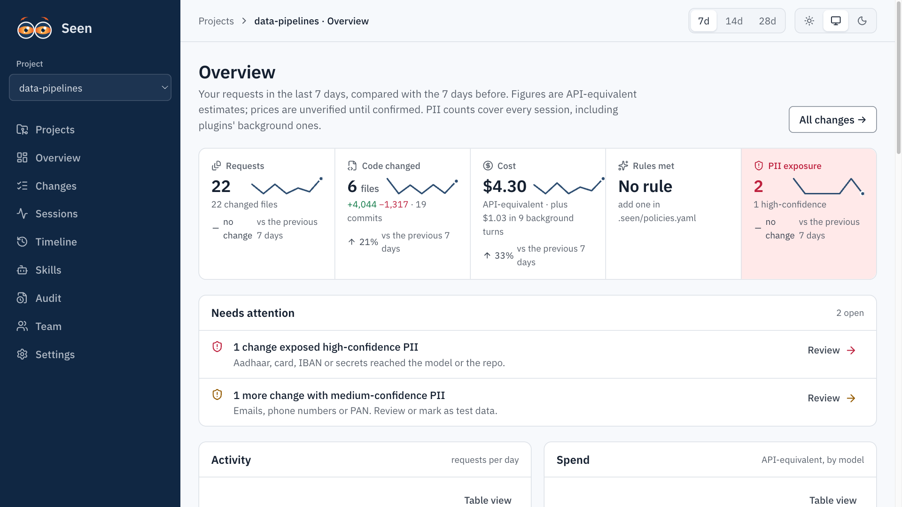

<p align="center"></p>

# Seen

[](https://github.com/surenganne/seen/actions/workflows/ci.yml)

**Nothing your agents do goes unseen.** A Claude Code plugin and local dashboard that keeps a per-project
ledger of what AI agents change: files and lines, tokens and API-equivalent cost, skills run
(with versions and approvals), required-skill rules, PII exposure, and a tamper-evident audit trail.

Local first: everything works with no server. Prompts and diffs never leave the machine.

**Status: early.** Not on PyPI yet, and the dashboard UI is built from a clone. Needs Python 3.11+, [uv](https://docs.astral.sh/uv/) and Claude Code; Node 22 only to build the dashboard. Feedback and issues welcome.



*The Overview page on generated demo data (`seen dev-seed`), not a real session.*

## What it records, per agent turn

| | |
|---|---|
| Changes | Files touched and lines added/removed, reconciled to git |
| Cost | Input, output, cache read and write tokens (exact, from the transcript) and API-equivalent cost from `pricing/prices.json` |
| Timeline | What changed in the repo by day: who asked, what it changed, and the commit it ended on |
| Skills | Every skill that ran, its version hash, trigger, and approval status at that moment |
| Rules | `.seen/policies.yaml`: "changes to `llm/**` must run `phi-redaction-check`" (report or enforce) |
| PII | Types and counts of personal data and secrets that reached the model, the network or the repo, and from where. Never the values |
| Audit | Append-only, hash-chained events. `seen audit verify` finds the first edited, deleted or reordered row |

## Install

```bash
# 1. CLI and the seen-hook binary (Python 3.11+, uv)
uv tool install "git+https://github.com/surenganne/seen#subdirectory=packages/cli"

# 2. Claude Code plugin (marketplace "seen-tools" lives in this repo)
claude plugin marketplace add surenganne/seen
claude plugin install seen@seen-tools

# 3. Per repo
cd your-repo && seen init          # .seen/ folder: policies, PII rules, skills lockfile
seen doctor                        # checks Python, hooks, plugin, databases, PATH
```

Then restart Claude Code. Upgrades, team-wide enablement and more commands: [docs/install.md](docs/install.md).

## Use

```bash
seen report --days 7          # what changed, what it cost, which skills ran
seen serve --open             # the dashboard on your real data (build it once, see below)
seen audit verify             # check the hash chain
```

## Dashboard

A local web UI over the same ledger: Overview, Changes, Sessions, Timeline, Skills, Audit and Settings, with every
summary linked to the rows behind it. The UI is a built bundle that is not packaged with the CLI, so build it once
from a clone:

```bash
git clone https://github.com/surenganne/seen && cd seen
(cd web && npm ci && npm run build)
SEEN_WEB_DIST=$PWD/web/dist seen serve --port 47825 --open     # http://127.0.0.1:47825
```

The dashboard has no login: it binds to 127.0.0.1 only. Do not publish its port beyond localhost. Other ways to run
it (from a clone, in Docker, for UI development) are in [docs/docker.md](docs/docker.md). `seen dev-seed --home <scratch dir>`
fills a throwaway home with generated data for trying the UI; it refuses `~/.seen`.

## How it works


Hooks never touch the network or write SQLite: they append to a spool file and ingest folds it into the ledger and the
hash-chained audit database when the turn stops. An optional team server (off by default, metadata only) is described in
[docs/team-server.md](docs/team-server.md). Source: [docs/architecture.html](docs/architecture.html).

## Limits, stated plainly

- **Tamper-evident, not tamper-proof.** Someone with write access to this machine can rebuild the audit chain.
- **Coverage.** Only sessions where the plugin ran are recorded, and sessions outside a git repository record nothing.
- **One agent per working tree.** If two agents edit the same repo at once, a turn's file changes can be credited to the wrong one.
- **PII detection** finds structured identifiers (Aadhaar, PAN, cards, IBAN, secrets…). It misses names and free text,
  cannot un-send what already reached the model provider, and is evidence for a privacy review, not a compliance control.
- **Cost** is an API-equivalent estimate from a price table that is not verified against current provider pricing.
- **Data at rest** is not encrypted by Seen: use disk encryption.

The full list is in [docs/limits.md](docs/limits.md).

## Docs

| | |
|---|---|
| [docs/install.md](docs/install.md) | Upgrade, enable for a team, more commands |
| [docs/docker.md](docs/docker.md) | Docker dashboard and run modes |
| [docs/team-server.md](docs/team-server.md) | Optional team server and SSO |
| [docs/limits.md](docs/limits.md) | Limits, in full |
| [docs/TESTING.md](docs/TESTING.md) | Step-by-step guide to check every feature by hand |
| [DESIGN.md](DESIGN.md) / [PRODUCT.md](PRODUCT.md) | Dashboard design system and who it is for |
| [docs/schema.md](docs/schema.md) | Where every piece of data lives |
| [docs/pii-benchmark.md](docs/pii-benchmark.md) | Detector precision and recall on the labelled corpus |
| [CONTRIBUTING.md](CONTRIBUTING.md) | Develop, test, send a pull request |

## License

[MIT](LICENSE).
